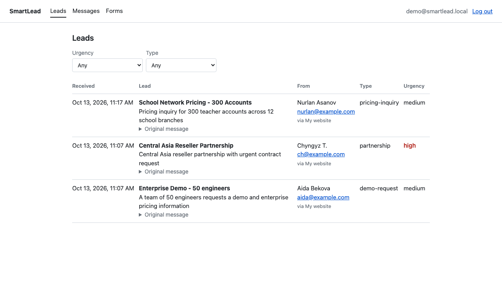
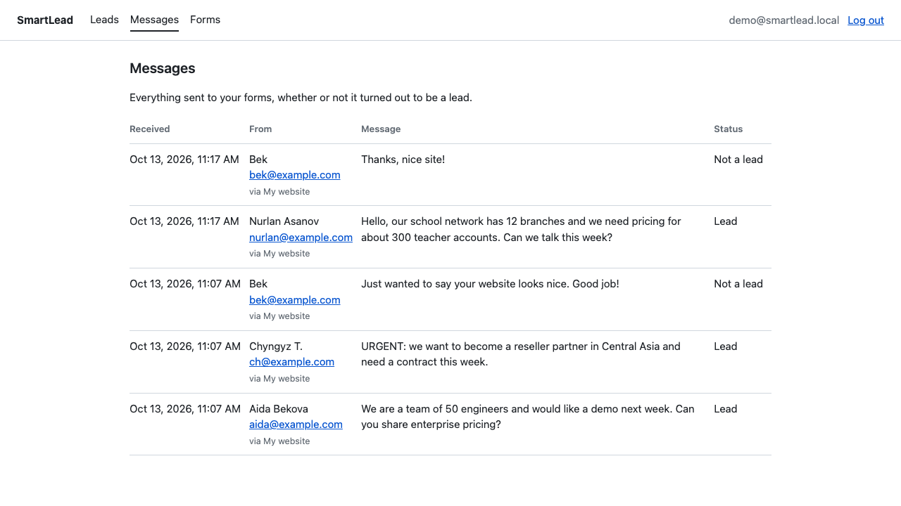
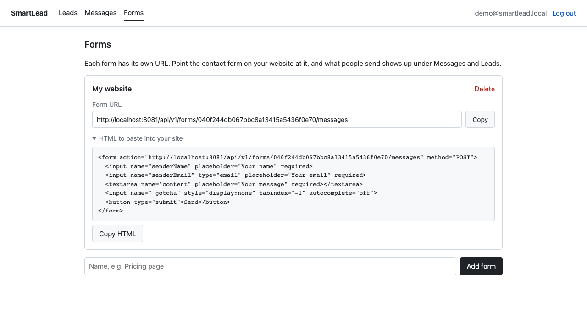
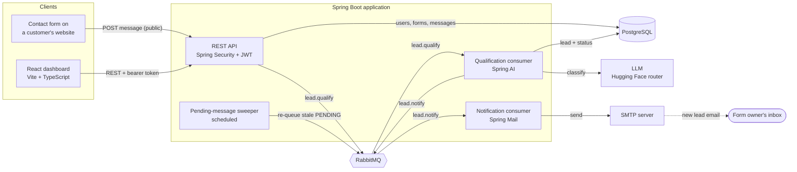
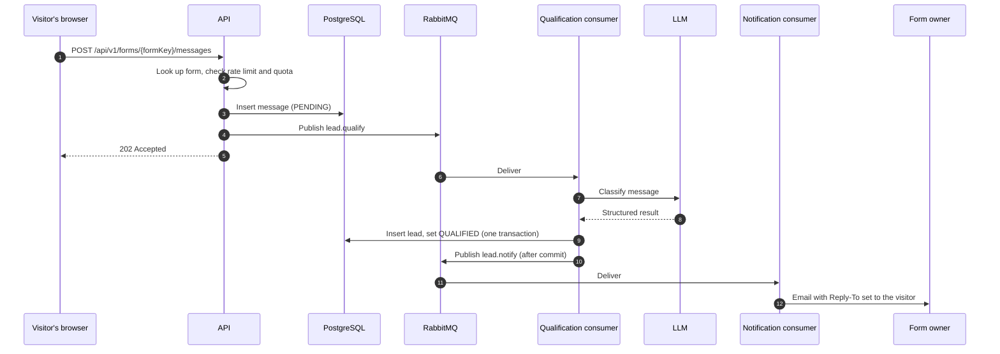
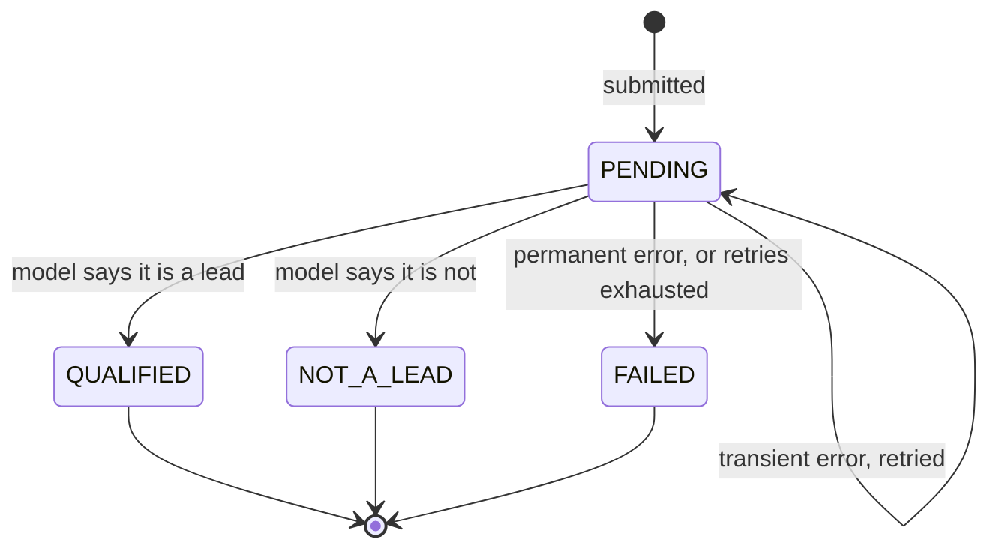
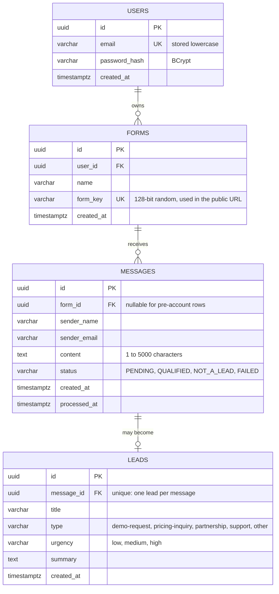

# SmartLead

A contact-form backend that reads every message with an LLM and tells you which ones are sales leads.

You sign up, get a form URL, and point your website's contact form at it. Each submission is stored, classified in the background (lead or not, type, urgency, a one-line summary), and shown in a dashboard. When a message turns out to be a lead, you get an email you can reply to directly.



## Contents

- [Features](#features)
- [Architecture](#architecture)
- [How a message is processed](#how-a-message-is-processed)
- [Reliability](#reliability)
- [Data model](#data-model)
- [Tech stack](#tech-stack)
- [Getting started](#getting-started)
- [Configuration](#configuration)
- [API](#api)
- [Tests](#tests)
- [Project layout](#project-layout)
- [Limitations](#limitations)

## Features

- **Accounts.** Register and log in; passwords are hashed with BCrypt and sessions are stateless JWTs.
- **A URL per form.** Each form has an unguessable public endpoint that accepts JSON or a plain HTML form post, so it works on a static site with no JavaScript.
- **AI qualification.** Spring AI sends each message to an LLM and parses the reply into a typed result: lead or not, type, urgency, title, summary.
- **Asynchronous by design.** Submissions return immediately; classification runs through RabbitMQ with retries and a dead-letter queue.
- **Email notifications.** The form owner is emailed about each new lead, with Reply-To set to the person who wrote in.
- **Data isolation.** Users only ever see messages and leads from their own forms.
- **Abuse protection.** A honeypot field, a per-minute rate limit, and a monthly quota per account, since every submission costs a model call.

| Messages | Forms |
| --- | --- |
|  |  |

## Architecture



The API, both consumers, and the sweeper run in one Spring Boot process. They only talk to each other through PostgreSQL and RabbitMQ, so the consumers could be moved into their own service without changing how they work.

## How a message is processed



The model call happens outside any database transaction, so a slow model never holds a connection open. The result is validated against the values the schema allows before it is saved: an unknown type falls back to `other`, an unknown urgency to `medium`.

## Reliability

A message is always in exactly one of four states.



| Problem | What happens |
| --- | --- |
| Model returns 5xx, 429, or times out | Retried up to 3 times with exponential backoff (2s, 4s). |
| Retries exhausted | The request is dead-lettered and a DLQ consumer marks the message `FAILED`. |
| Model rejects the request (bad key, no credits, unknown model) | Marked `FAILED` immediately; retrying would not help. |
| RabbitMQ is down when a message is submitted | The message is already saved, so the API still returns 202. A sweeper re-queues anything `PENDING` for more than 5 minutes. |
| The same request is delivered twice | The consumer skips messages that are no longer `PENDING`, and `leads.message_id` is unique. |
| Model returns a value the schema does not allow | Normalized or replaced with a safe default before saving. |
| Mail server is down | The email is retried, then parked in `lead.notification.dlq`. The lead is saved either way. |

Queues and exchanges:

| Queue | Routing key | Consumer | Dead-letters to |
| --- | --- | --- | --- |
| `lead.qualification` | `lead.qualify` | Classifies the message | `lead.qualification.dlq` |
| `lead.qualification.dlq` | | Marks the message `FAILED` | |
| `lead.notification` | `lead.notify` | Sends the email | `lead.notification.dlq` |
| `lead.notification.dlq` | | None; kept for inspection | |

## Data model



- Ownership runs `lead → message → form → user`. Every dashboard query filters on that chain, and another user's id returns 404 rather than 403 so ids cannot be probed.
- Deleting a user or a form cascades to its messages and leads.
- `status`, `type`, and `urgency` are enforced by `CHECK` constraints, not only in application code.
- The schema is managed by Flyway (`src/main/resources/db/migration`); Hibernate only validates it.

## Tech stack

| Area | Technology |
| --- | --- |
| Backend | Java 21, Spring Boot 3.4, Spring Web, Spring Data JPA, Bean Validation |
| AI | Spring AI 1.0 (`ChatClient` with structured output) against the Hugging Face router, which speaks the OpenAI API |
| Messaging | RabbitMQ 4 with Spring AMQP |
| Database | PostgreSQL 16, Flyway |
| Security | Spring Security, OAuth2 resource server (HS256 JWT), BCrypt |
| Email | Spring Mail; Mailpit as a local mail catcher |
| Frontend | React 19, TypeScript, Vite, React Router |
| Testing | JUnit 5, Testcontainers (PostgreSQL, RabbitMQ), Mockito, Awaitility |
| Docs | springdoc-openapi (Swagger UI) |

## Getting started

You need Java 21 or newer, Node.js 20 or newer, and Docker running.

**1. Get a model API key.** Create a [Hugging Face access token](https://huggingface.co/settings/tokens) with the "Make calls to Inference Providers" permission. The account needs inference credits.

**2. Start the backend.** PostgreSQL, RabbitMQ, and Mailpit are started for you from `compose.yaml`.

```bash
export SMARTLEAD_API_KEY=hf_your_token
./mvnw spring-boot:run
```

**3. Start the dashboard** in a second terminal.

```bash
cd frontend
npm install
npm run dev
```

**4. Use it.** Open http://localhost:5173, create an account, and copy your form URL from the Forms page. Then send a message to it:

```bash
curl -X POST http://localhost:8081/api/v1/forms/YOUR_FORM_KEY/messages \
  -H "Content-Type: application/json" \
  -d '{"senderName":"Aida","senderEmail":"aida@example.com","content":"We are a team of 50 and would like a demo next week."}'
```

A moment later it appears under Messages and Leads, and the notification email arrives in Mailpit.

| What | Address |
| --- | --- |
| Dashboard | http://localhost:5173 |
| API | http://localhost:8081 |
| Swagger UI | http://localhost:8081/swagger-ui.html |
| Mailpit (sent emails) | http://localhost:8025 |
| RabbitMQ management | http://localhost:15672 (`smartlead` / `smartlead`) |
| PostgreSQL | `localhost:5439`, database `smartlead` (`postgres` / `postgres`) |

## Configuration

Everything has a local default except the model key.

| Variable | Default | Purpose |
| --- | --- | --- |
| `SMARTLEAD_API_KEY` | none, required | Hugging Face token used for model calls |
| `JWT_SECRET` | a development-only value | Signing key for login tokens. **Set this anywhere but your own machine.** At least 32 characters. |
| `DB_URL`, `DB_USERNAME`, `DB_PASSWORD` | local PostgreSQL | Database connection |
| `RABBITMQ_HOST`, `RABBITMQ_PORT`, `RABBITMQ_USERNAME`, `RABBITMQ_PASSWORD` | local RabbitMQ | Broker connection |
| `SMTP_HOST`, `SMTP_PORT` | `localhost`, `1025` (Mailpit) | Mail server |
| `SMTP_USERNAME`, `SMTP_PASSWORD`, `SMTP_AUTH`, `SMTP_STARTTLS` | empty, empty, `false`, `false` | Credentials for a real mail provider |
| `MAIL_FROM` | `SmartLead <notifications@smartlead.local>` | Sender of notification emails |
| `DASHBOARD_URL` | `http://localhost:5173` | Link included in notification emails |
| `VITE_API_URL` (frontend) | `http://localhost:8081` | Backend address shown to users as their form URL |

The model, rate limit (10 per minute per form and address), and monthly quota (500 per account) are set in `application.properties`.

## API

Interactive documentation is at `/swagger-ui.html`.

| Method | Path | Auth | Description |
| --- | --- | --- | --- |
| `POST` | `/api/v1/auth/register` | Public | Create an account; returns a token. A first form is created with it. |
| `POST` | `/api/v1/auth/login` | Public | Returns a token. |
| `POST` | `/api/v1/forms/{formKey}/messages` | Public | Submit a message. Accepts JSON or `application/x-www-form-urlencoded`. Callable from any origin. |
| `GET` | `/api/v1/forms` | Bearer | List your forms. |
| `POST` | `/api/v1/forms` | Bearer | Create a form. |
| `DELETE` | `/api/v1/forms/{id}` | Bearer | Delete a form with its messages and leads. |
| `GET` | `/api/v1/messages` | Bearer | Your messages, paged. |
| `GET` | `/api/v1/leads` | Bearer | Your leads, paged. Optional `type` and `urgency` filters. |
| `GET` | `/api/v1/leads/{id}` | Bearer | One lead. |

A submission needs three fields: `senderName`, `senderEmail`, and `content`. For a plain HTML form, the Forms page generates a snippet like this one; `_gotcha` is a hidden honeypot that real visitors never fill in.

```html
<form action="http://localhost:8081/api/v1/forms/YOUR_FORM_KEY/messages" method="POST">
  <input name="senderName" placeholder="Your name" required>
  <input name="senderEmail" type="email" placeholder="Your email" required>
  <textarea name="content" placeholder="Your message" required></textarea>
  <input name="_gotcha" style="display:none" tabindex="-1" autocomplete="off">
  <button type="submit">Send</button>
</form>
```

## Tests

```bash
./mvnw test
```

Docker must be running. The integration tests start real PostgreSQL and RabbitMQ containers with Testcontainers and drive the application over HTTP; only the model and the mail sender are replaced with mocks, so no credits are spent. They cover:

- the qualification outcomes, including normalizing model output that would otherwise break a database constraint
- retry of transient model errors, dead-lettering after three attempts, and no retry for permanent errors
- registration, login, and rejection of requests without a valid token
- isolation between two accounts
- JSON and HTML form submissions, the honeypot, rate limiting, and CORS on the public endpoint
- notification emails: sent for leads, not sent otherwise, retried on failure

## Project layout

```
src/main/java/com/samagan/smartlead
├── auth           registration, login, token issuing
├── form           forms and their public keys
├── message        public submission endpoint, rate limiter, sweeper, message listing
├── lead           classification (Spring AI), queue consumer, result persistence, leads API
├── notification   lead emails
├── config         security, RabbitMQ topology, OpenAPI
└── exception      error responses

src/main/resources/db/migration   Flyway migrations
frontend/                         React dashboard
compose.yaml                      PostgreSQL, RabbitMQ, Mailpit for local development
```

## Limitations

Things that are deliberately simple, and what would replace them:

- The rate limiter is in memory, so it only works for a single instance. Several instances would need a shared store such as Redis.
- Login is not throttled against password guessing.
- A plain HTML form post that fails validation gets a JSON error instead of a page.
- Publishing to RabbitMQ after the database commit is covered by the sweeper rather than a transactional outbox.
- Failed notification emails are parked in a dead-letter queue but not reported anywhere.
- The dashboard keeps the token in `localStorage` and expects to be served from the same origin as the API.
- There is no deployment setup or CI pipeline yet.
